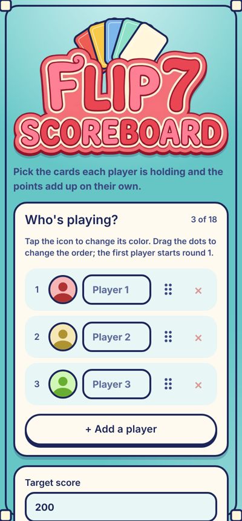
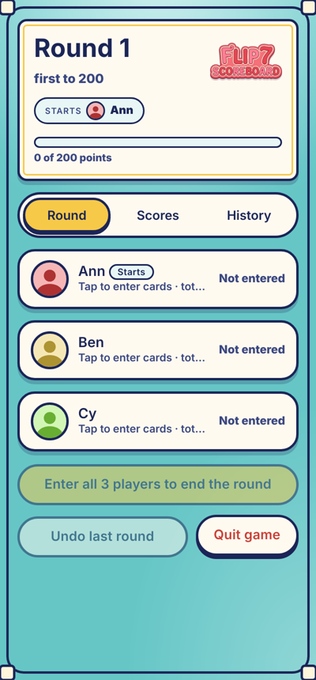
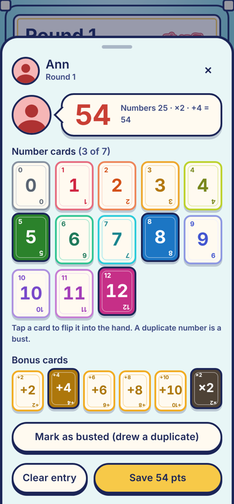

<div align="center">


### A friendly scorekeeper for the card game **Flip 7**

Tap the cards each player is holding, and the points add up on their own.
Rounds, standings and the winner are handled for you, all on one device.

[](https://vuejs.org)
[](https://www.typescriptlang.org)
[](https://vitejs.dev)
[](#testing)
[](LICENSE)

</div>

<p align="center">
  
  &nbsp;
  
  &nbsp;
  
</p>

> Unofficial fan-made companion. It contains no game content beyond card numbers and scoring rules, and is not affiliated with the publisher of Flip 7.

## Features

- **Pick cards, get the score.** Number cards 0 to 12 and the bonus cards (+2, +4, +6, +8, +10, ×2) are shown as real-looking cards that flip over when selected. The score updates live.
- **Flip 7 bonus built in.** Seven different numbers earns the +15 bonus automatically.
- **Bust handling.** Mark a player as busted and they score 0 for the round.
- **3 to 18 players**, each with a coloured avatar. Drag to set the seating order.
- **Round tracking.** Rounds are counted, and the starting player moves one seat every round.
- **Target score and winner.** Default 200 (editable). The game ends when the top score reaches the target and isn't tied; ties play on.
- **Fix mistakes.** Undo the last round, or tap any score in History to correct it.
- **Remembers you.** Everything is stored in the browser, so a game survives a refresh, and returning players get "Start a new game" or "Settings" with their last setup prefilled.
- **Phone first.** Big touch targets, safe-area aware, respects reduced-motion settings.

## Scoring

```
score = (sum of number cards × (×2 ? 2 : 1))
      + (sum of +N bonus cards)
      + (15 if exactly 7 different number cards)

bust  = 0
```

## Getting started

Requires Node.js 20 or newer.

```bash
npm install
npm run dev        # dev server, also reachable from your phone on the same Wi-Fi
npm test           # unit tests
npm run build      # type-check and production build into dist/
npm run preview    # serve the production build
```

## Deploy to GitHub Pages

The repo includes a workflow (`.github/workflows/pages.yml`) that tests, builds and publishes on every push to `main`.

1. Push the project to a GitHub repository.
2. Open **Settings → Pages** and set **Source** to **GitHub Actions**.
3. Push to `main`. The site appears at `https://<your-user>.github.io/<repo>/`.

The app uses relative asset paths and hash-based routing, so it works under any repository sub-path without extra configuration.

## Project structure

```
src/
├── components/   CardPicker, PlayingCard, PlayerRow, RoundHeader,
│                 Scoreboard, RoundHistory, WinnerScreen, PlayerSetupForm, …
├── stores/       game.ts: Pinia store (players, rounds, drafts, winner, undo, persistence)
├── utils/        scoring.ts (pure score maths), cardColors.ts, avatars.ts
├── views/        SetupView (/), GameView (/game), ResultsView (/results)
├── router/       hash-history router with direction-aware page transitions
└── style.css     theme tokens and all styles
```

## Testing

Vitest covers the scoring rules (duplicates, ×2 ordering, the Flip 7 bonus, busts) and the game store (rotation, ties, undo, editing past rounds, saved-data migration).

```bash
npm test
```

## Tech

Vue 3 (`<script setup>`), TypeScript, Pinia, Vue Router, Vite and Vitest. No backend and no tracking: all data stays in your browser's `localStorage`.

## License

[MIT](LICENSE)
